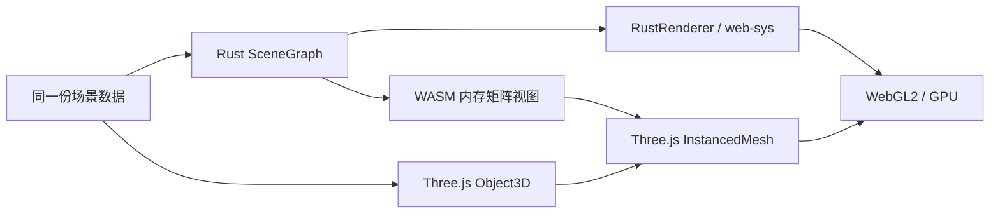

# Three × Rust：Three.js 风格的 Rust / WebAssembly 实验

[](https://github.com/sakorman/three-wasm-rust/actions/workflows/ci.yml)
[](LICENSE)

效仿 [takahirox/three.wasm-experimental](https://github.com/takahirox/three.wasm-experimental)，把原项目的 C/C++ + Emscripten 实验方向改用 **Rust + WebAssembly + wasm-bindgen** 实现。

这里有一个真正由 Rust 编译的 WASM 内核：它负责矩阵运算、场景层级更新，并能通过 `web-sys` 直接调用 WebGL2 绘制实例化几何体。页面同时提供纯 Three.js 与混合模式，帮助观察把计算搬到 WASM 后，性能变化究竟来自哪里。

**这是可运行的图形实验项目，并非完整 Three.js 的 Rust 移植，也不是 Three.js API 的直接替代品。** GPU 仍执行 GLSL，浏览器 WebGL API 的调用仍经过绑定层。这里没有 C/C++ 源码，也不需要 Emscripten。


> 界面预览；截图中的瞬时计时不作为性能结论，请在自己的设备上运行对照测试。

## 1. 实现内容

- **Rust 数学内核**：TRS 合成、4×4 矩阵乘法、批量矩阵乘法、齐次坐标点变换。
- **Rust 场景图**：多个根节点、任意存储顺序的父子关系、重新设置父节点、循环引用检查、迭代式世界矩阵更新。
- **Rust WebGL2 渲染器**：索引三角形、实例矩阵、实例颜色、深度测试、背面剔除、一个实例化 draw call。
- **三条演示路径**：完整 Rust 路径、Rust + Three.js 混合路径、纯 JavaScript 路径。
- **中文交互演示**：1,000 / 5,000 / 10,000 / 20,000 个对象，拖动旋转、滚轮缩放、暂停/继续、重置视角。
- **五项性能实验**：场景更新、更新加矩阵导出、批量乘法、逐个乘法、函数调用开销，可下载原始 JSON 样本。
- **自动化验证**：Rust 单元测试、真实 WASM 与 Three.js 的差分测试、Chromium 浏览器测试、GitHub Actions CI。

## 2. 与参考项目的关系

原项目探索将 Three.js 风格的数学、场景对象和渲染逻辑迁移到 C/C++，通过 Emscripten 接入 JavaScript。本项目保留这一实验目的，重新设计数据布局与构建方式。

| 方面 | 参考项目 | 本项目 |
| --- | --- | --- |
| WASM 源语言 | C / C++ | Rust |
| 构建和绑定 | Emscripten、`ccall` / `cwrap` | Cargo、wasm-pack、wasm-bindgen |
| JS 接口 | 修改版 Three.js 与原生指针接口 | 独立 WASM 模块 + 官方 Three.js 对照 |
| 场景内存 | 对象和指针结构 | 连续 TRS 数组、稳定节点索引、连续世界矩阵 |
| 图形接口 | 基础 WebGL 实验 | WebGL2 实例化绘制 |
| 数值 | 原生部分大量使用 double | Rust f32；Three.js 内部使用 JS Number |
| 当前目标 | Three.js WASM 原型探索 | 小范围可运行实现、正确性校验、可解释性能实验 |

参考提交：`9009842ad7baa05d959cfb8cdab86f8b5cd01539`。来源说明及原项目 MIT 许可见 [THIRD_PARTY_NOTICES.md](THIRD_PARTY_NOTICES.md)。

## 3. 快速开始

需要 Node.js **20.19+**（推荐 Node.js 22 LTS）、npm、Rust stable 和支持 WebGL2 的浏览器。

### 3.1 安装 Rust

macOS / Linux：

```bash
curl --proto '=https' --tlsv1.2 -sSf https://sh.rustup.rs | sh
source "$HOME/.cargo/env"
rustup target add wasm32-unknown-unknown
```

Windows 请通过 [rustup 官方安装页](https://rustup.rs/) 安装，再在新终端运行 `rustup target add wasm32-unknown-unknown`。若编译提示缺少链接器，按 Rust 安装提示安装平台构建工具；macOS 通常为 Xcode Command Line Tools，Windows 为 MSVC Build Tools。

### 3.2 克隆并启动

```bash
git clone https://github.com/sakorman/three-wasm-rust.git
cd three-wasm-rust
npm ci
npm run dev
```

打开终端输出的本地地址，默认是 `http://127.0.0.1:5173`。

`npm run dev` 会先编译 Rust，生成 `pkg/` 中的 `.wasm`、JavaScript 绑定和 TypeScript 类型，再启动 Vite。首次运行会下载 Cargo 依赖及 wasm-bindgen 工具，耗时较长。`wasm-pack` 已锁定为 npm 开发依赖，无需另外全局安装。请勿直接双击 `index.html`，WASM 需要通过 HTTP 服务加载。

只修改前端时可用 `npm run dev:web`；修改 Rust 后需再次执行 `npm run build:wasm` 并刷新页面。Vite 不会自动监视和编译 Rust。

### 3.3 生产构建

```bash
npm run build
npm run preview
```

静态文件输出到 `dist/`，可以交给任意静态托管服务。Vite 使用相对 `base`，支持 GitHub Pages 这类仓库子路径。生产构建会把 WASM 打包为单独资源，不依赖外部 CDN。构建产物、依赖目录均不提交到 Git。

## 4. 三种运行模式

| 模式 | 动画 / 场景矩阵 | 绘制与 GPU 提交 | 适合观察 |
| --- | --- | --- | --- |
| Rust + WASM / 完整链路 | Rust | Rust 调用 web-sys WebGL2 | Rust 场景与渲染整体路径 |
| Rust 计算 / Three.js 渲染 | Rust | JS 读取矩阵并交给 Three.js InstancedMesh | 在现有 Three.js 中集成 Rust 计算 |
| Three.js / JavaScript 对照 | Three.js Object3D | Three.js InstancedMesh | JS 实现的对照成本 |

三种模式共享固定随机种子、几何体、颜色、GLSL、相机和绝对动画时间；每组 16 个节点中，第一个是根，其余节点是子节点。切换模式会恢复同一时刻的姿态。



这里的“完整链路”指 **场景变换和基础绘制提交** 在 Rust 内完成。相机交互、演示 UI 和几何体初始化仍由 JavaScript 完成；它不表示页面或 Three.js 全部运行于 WASM。

## 5. 数据约定与 API

构建后可以从 `pkg/three_wasm_rust.js` 导入接口；`pkg/three_wasm_rust.d.ts` 提供生成的类型声明。

### 5.1 创建层级场景

```js
import init, { SceneGraph } from './pkg/three_wasm_rust.js';

const wasm = await init();
const parents = new Int32Array([-1, 0]); // -1 表示根；节点 1 是节点 0 的子节点
const transforms = new Float32Array([
  // position xyz | quaternion xyzw | scale xyz
  10, 0, 0,        0, 0, 0, 1,        1, 1, 1,
   2, 0, 0,        0, 0, 0, 1,        1, 1, 1,
]);

const graph = new SceneGraph(parents, transforms);
graph.update_world_matrices();
console.log(graph.world_matrices()[16 + 12]); // 12：子节点世界坐标 x

graph.reparent(1, -1); // 保留局部 TRS，变为独立根节点
graph.update_world_matrices();
console.log(graph.world_matrices()[16 + 12]); // 2

graph.free(); // 主动释放 Rust 对象；此后不要继续调用该对象
```

约定如下：

- 一个节点对应 **10 个 f32**：位置 3 个、四元数 4 个、缩放 3 个。
- 四元数使用 `x, y, z, w` 顺序；写入时归一化，零长度四元数会被拒绝。
- 矩阵为 **列主序**，使用列向量，平移在索引 `12, 13, 14`，与 Three.js/WebGL 一致。
- 世界变换为 `parentWorld × local`，局部矩阵为 `T × R × S`。
- 父节点可以出现在子节点之后；遍历顺序由 Rust 在构造/改父节点时计算。
- 不允许循环、自引用、越界父节点、NaN 或 Infinity 输入。失败的修改不破坏旧场景。
- 节点上限为 100,000；节点数量固定，需要增删节点时重新创建场景。UI 限制为 20,000。
- 使用迭代式遍历，不因深层级递归而栈溢出；每次更新会重算全部节点，没有脏标记优化。
- 输入应处于合理数值范围；有限 f32 连乘仍可能溢出，本项目不处理极端坐标范围。

| 接口 | 作用 |
| --- | --- |
| `new SceneGraph(parents, transforms)` | 校验拓扑、复制输入并计算初始世界矩阵 |
| `node_count()` | 节点数量 |
| `set_transform(id, packed10)` | 更新单个节点局部 TRS |
| `set_transforms(packed10N)` | 批量更新局部 TRS |
| `reparent(id, parent)` | 修改父节点，保留局部变换，拒绝循环 |
| `update_world_matrices()` | 计算全部世界矩阵 |
| `animate_demo(seconds)` | 演示专用：覆盖局部旋转并更新世界矩阵，不用于通用动画系统 |
| `world_matrices()` | 返回独立的 Float32Array 副本 |
| `matrices_ptr()` / `matrices_len()` | 获取借用视图所需的字节指针 / f32 个数 |
| `free()` | 释放 Rust 对象 |

### 5.2 把 Rust 结果交给 Three.js

```js
// graph 和 wasm 沿用上例，但应在 graph.free() 之前执行。
// mesh 是已创建的 THREE.InstancedMesh，实例数量必须等于节点数量。
graph.update_world_matrices();
const matrices = new Float32Array(
  wasm.memory.buffer,
  graph.matrices_ptr(),
  graph.matrices_len(),
);
mesh.instanceMatrix.array.set(matrices);
mesh.instanceMatrix.needsUpdate = true;
mesh.frustumCulled = false; // 演示禁用整体剔除，避免沿用已过期包围体
```

**借用视图不是永久引用。** WASM 内存增长会使旧 `ArrayBuffer` / TypedArray 失效；任何可能分配内存的 WASM 调用之后，都应重新获取视图。`graph.free()` 后原视图不能再使用。项目中的 `matrixView()` 每次重建视图，不缓存旧内存。

“借用视图”只省去 WASM 到 JS 的一份数组复制；以上 `.set()` 以及向 GPU 上传仍有数据传输成本。需要长期保存结果时使用 `world_matrices()`。Rust 自有渲染器直接用世界矩阵切片提交 GPU，也不能省去 GPU 上传。

### 5.3 Rust 直接绘制

```js
import { RustRenderer } from './pkg/three_wasm_rust.js';

// canvas: HTMLCanvasElement
// positions: Float32Array，每个顶点 xyz
// indices: Uint32Array，每三个索引构成一个三角形
// colors: Float32Array，每个节点一个 RGB，范围 [0, 1]
const renderer = new RustRenderer(canvas, positions, indices, colors);

// 外部相机生成 projectionMatrix × matrixWorldInverse，按列主序传入。
graph.update_world_matrices();
renderer.render(graph, viewProjectionFloat32Array);

renderer.free(); // 释放 program、VAO、顶点/索引/实例 GPU 缓冲
```

所有节点共享同一份几何体，每个节点都会绘制一个实例。实例颜色在渲染器构造时上传，几何体与颜色不支持原地修改；需要变化时重新创建渲染器。`render()` 不会隐式计算世界矩阵，调用方应先更新。顶点着色器与片元着色器保存在 `web/shaders/`，Rust 与 Three.js 读取同一份源码。

### 5.4 数学函数

| 函数 | 输入 / 输出 |
| --- | --- |
| `compose_transform(trs)` | 10 个 f32 → 16 个 f32 |
| `multiply_matrices(a, b)` | 两个 16 元素数组 → `a × b` |
| `multiply_matrices_batch(a, b)` | 两个 `16 × N` 数组 → N 组矩阵乘积 |
| `transform_points(matrix, points)` | 16 元素矩阵 + xyz 点数组 → 齐次变换后的 xyz；w 接近零时拒绝 |
| `identity_matrix()` | 返回单位矩阵 |
| `identity_value(value)` | 原样返回 f64，供调用开销实验 |

以上数组 API 会通过绑定层复制输入/输出；大量小调用可能比 JS 更慢，优先批量计算或把长期状态保存在 `SceneGraph` 中。

## 6. 如何理解性能测试

点击“运行性能对照”后，演示暂停计算与渲染，完成后恢复之前的动画状态。

| 测试项 | 计时范围 |
| --- | --- |
| 场景矩阵更新 | 完整节点 TRS 合成与父子世界矩阵更新；Rust 状态常驻 WASM，JS 使用实际 Object3D |
| 更新 + JS 可用矩阵 | 上述更新加 JS 侧连续矩阵输出；Rust 路径使用借用视图，JS 路径从各对象收集矩阵 |
| 批量矩阵乘法 | 最多 10,000 对矩阵；包括 WASM 绑定的输入/输出复制 |
| 逐个矩阵乘法 | 1,000 次逐个调用；包括跨边界和数组复制，用来观察小任务的代价 |
| 函数调用开销 | 10,000 次 identity 调用；JS 函数可能被 JIT 内联，结果不是硬件级边界常数 |

每项预热 10 次，再采样 7 轮，每轮运行多次，交替执行 JS 和 WASM，报告每次操作的中位毫秒数。导出的 JSON 包含全部样本、最小值/最大值、迭代次数、对象数、随机种子、浏览器信息、CPU 逻辑核心数、DPR 和 Three.js revision。

**比值是 `JS 耗时 / WASM 耗时`：大于 1 表示本项 WASM 更快，小于 1 表示 JS 更快。** 不预填跑分，也不保证 Rust/WASM 总会领先。

比较时请注意：

1. Rust 使用 f32，Three.js 内部使用 JS Number，两者精度和数据布局不同；这是两种实现路径的实验，不是仅替换编程语言的严格控制实验。
2. 场景图测试包含 TRS 合成，未计入每帧演示动画的三角函数计算。场景创建、数据准备和 shader 编译不在基准计时内。
3. 页面“提交渲染”是 CPU 侧矩阵收集/复制/驱动提交耗时，**不是 GPU 完成时间**。未使用 GPU timer query 或 `gl.finish()`。
4. 所有模式均使用实例化、相同 GLSL 和一个 draw call，避免拿逐对象渲染与实例化渲染作直接对比；驱动调用路径仍不完全相同。
5. FPS 受显示器刷新率、浏览器节流、GPU、抗锯齿、DPR 和后台任务影响，不适合单独证明 WASM 提速。
6. 计时器精度可能让微小任务出现 0；UI 会标明低于计时精度。请多次测试，保留原始报告，尽量保持标签页前台。
7. Headless / CI 常使用软件 GPU，适合检查功能，不应拿来代表真实设备的渲染性能。

## 7. 测试与开发命令

```bash
# 首次安装浏览器（Linux CI 使用 --with-deps）
npx playwright install chromium

# 格式 + Rust 静态检查
npm run check
cargo clippy --target wasm32-unknown-unknown --locked -- -D warnings

# 完整测试：Rust → WASM 构建 → Node 差分 → Chromium
npm test

# 或分别执行
npm run test:rust
npm run build:wasm
npm run test:integration
npm run test:e2e
```

验证内容包括：

- 列主序、平移/缩放组合、四元数归一化、齐次坐标处理。
- 任意父子存储顺序、改父节点、循环/越界输入、空场景、20,000 层深度。
- 真实 WASM 与 Three.js 的数学差分、5,000 节点多时刻动画对比。
- WASM 内存增长后旧视图失效、新视图正确；重复创建/释放。
- 实际 WebGL 像素输出和错误码、三种模式、场景规模、相机操作、报告导出、390px 移动端布局、缺少 WebGL2 时的错误提示。

CI 自动执行检查、测试与生产构建，保留截图/报告，并将 `dist/` 上传为 `static-demo` artifact。生成的 `.wasm` 不提交，因此需要先构建再执行独立的 integration/e2e 命令。

## 8. 部署到 GitHub Pages

仓库附带手动触发的 Pages 工作流，避免每次提交都自动发布：

1. 在仓库 **Settings → Pages → Build and deployment → Source** 中选择 **GitHub Actions**。
2. 打开 **Actions → Deploy demo to GitHub Pages → Run workflow**。
3. 等待部署成功，访问工作流输出的地址；此仓库默认对应 `https://sakorman.github.io/three-wasm-rust/`。

这个地址只有在 Pages 已配置且工作流成功后才可访问。普通 CI 的绿色状态不代表已经部署。

## 9. 目录结构

```text
src/
  lib.rs                 WASM 导出、SceneGraph 与校验
  math.rs                Rust 矩阵 / TRS 计算
  renderer.rs            Rust WebGL2 渲染与资源释放
web/
  main.js                演示状态、相机、三种模式
  scene.js               固定种子数据与 Three.js 对照
  benchmark.js           性能采样与结果元数据
  shaders/               两种渲染器共享的 GLSL
  style.css              中文演示界面
tests/
  integration.test.mjs   真实 WASM 对比 Three.js
  browser/demo.spec.js   浏览器功能与绘制检查
.github/workflows/      CI 与手动 Pages 发布
Cargo.lock              Rust 依赖锁定
package-lock.json       npm 依赖锁定
pkg/                    生成的 WASM、JS、类型声明（忽略）
dist/                   静态构建产物（忽略）
```

## 10. 当前边界与后续方向

当前只实现一个紧凑的实验范围。尚未包含完整 Object3D/Scene/Mesh 类体系、多几何体与多材质管理、纹理/PBR、透明排序、视锥剔除、阴影、骨骼动画、模型加载、WebGPU、WASM SIMD、Worker 或多线程，也不是 3D Gaussian Splatting 渲染器。

Rust 渲染器目前只支持所有节点共享一份索引三角形几何体。着色采用简单的屏幕导数面光照，不等同于 Three.js 的完整材质系统。WebGL 上下文丢失会显示错误并要求刷新，没有自动恢复 GPU 资源。

适合继续扩展的方向是：脏标记更新与批量数据写入、Rust 侧视锥剔除、SIMD 对照、GPU timer query、Worker 数据交换，以及更接近真实应用的混合场景。扩展时建议继续保留 Three.js 差分测试与明确的计时边界。

## 11. 常见问题

**`cargo: command not found`**：重启终端或运行 `source "$HOME/.cargo/env"`，确认 `rustc --version` 可用。

**缺少 `wasm32-unknown-unknown`**：运行 `rustup target add wasm32-unknown-unknown`。仓库的 `rust-toolchain.toml` 也声明了该目标。

**Apple Silicon 上出现 `Unrecognized target` / `Installing wasm-bindgen`**：wasm-pack 可能回退到从源码安装绑定工具，首次运行会较慢。可从 [wasm-bindgen 官方 Releases](https://github.com/wasm-bindgen/wasm-bindgen/releases) 下载与 `Cargo.lock` 中版本一致的 `aarch64-apple-darwin` 工具包，校验发布的 SHA-256 后将 `wasm-bindgen` 放入 PATH；也可执行 `cargo install wasm-bindgen-cli --version 0.2.129 --locked`。更新 Rust 依赖后，CLI 版本也必须同步。

**找不到 `pkg/three_wasm_rust.js`**：先运行 `npm run build:wasm`；源码仓库不包含生成文件。

**页面无图形**：检查页面错误提示、浏览器 WebGL2/硬件加速设置及控制台；若上下文丢失，请刷新。浏览器测试通过实际像素检测防止把空白画布误当成渲染成功。

**修改 Rust 后页面没变化**：重新构建 WASM，再刷新页面。前端 HMR 不会重新编译 Cargo。

**WASM 比 JS 慢**：小任务可能被跨语言调用和数据复制主导；先看批量测试，再检查长期状态是否仍反复往返复制。

**需要 COOP/COEP 吗？** 当前实现不使用 SharedArrayBuffer 或多线程，不需要为本项目配置跨源隔离。

**可直接发布到 npm 吗？** 根 `package.json` 设置了 `private: true`，此版本按实验仓库交付。`pkg/` 是 wasm-pack 生成的可分发模块结构，正式发布前应单独设计包名、API 稳定性和发布流程。

## 12. 参考与许可

- [原始实验项目](https://github.com/takahirox/three.wasm-experimental)
- [wasm-bindgen 文档](https://wasm-bindgen.github.io/wasm-bindgen/)
- [wasm-pack 构建说明](https://drager.github.io/wasm-pack/book/commands/build.html)
- [Three.js 文档](https://threejs.org/docs/)

本项目使用 [MIT License](LICENSE)。感谢原作者的实验方向与相关开源工具。
