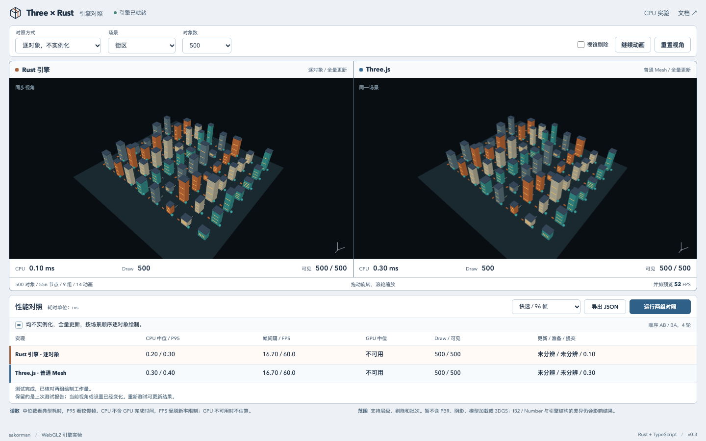

# Three × Rust

[](https://github.com/sakorman/three-wasm-rust/actions/workflows/ci.yml)
[](LICENSE)

[在线演示](https://sakorman.github.io/three-wasm-rust/) · [CPU 小型测试](https://sakorman.github.io/three-wasm-rust/lab.html) · [更新记录](CHANGELOG.md)

一个用 Rust 和 TypeScript 写的浏览器场景引擎。Rust 编译成 WASM，负责层级更新、可见性判断、批次整理和 WebGL2 绘制提交。相机、几何体生成和 TS 接口也在仓库里，可以单独拿出来使用。

首页默认让 Rust 和 Three.js 都逐对象绘制，不使用实例化。两边同步视角、全量更新矩阵，正式测试时逐组运行。也可以切换到“两边都实例化”的独立对照。

目前是 **0.3 引擎原型**，适合研究不透明几何体场景和 CPU/GPU 分工。还没有纹理、PBR、阴影或模型加载。3DGS 已加入协方差投影、屏幕低通滤波与不透明度补偿、屏幕范围、不透明度、中心/支持范围深度及视口筛选、稳定排序、瓦片分箱、瓦片内深度排序和范围打包，完整高斯场景渲染尚未接入，详见[高斯光栅化准备](docs/gaussian-rendering.md)。



首页采用一屏工作台布局：参数在顶部，双画布居中，完整结果紧接在下方。窄窗口会把结果排成两列，保留全部指标；测试前后画布尺寸不变。测试说明集中在本文，页面只保留操作、数据和简短状态。已检查 532×863 的应用内窗口及常见桌面尺寸，极小高度或高倍缩放时允许滚动以保证可读性。

## 现在有哪些东西

- **场景图**：固定数量的节点、多根层级、改父节点、输入及矩阵溢出校验。局部变换没变化时跳过矩阵重算，父节点变化会传递给后代。
- **渲染队列**：支持自定义球心与半径的视锥剔除；逐对象路径保留场景顺序，实例化路径按几何体、材质和朝向打包矩阵。
- **WebGL2 渲染器**：逐对象 `drawElements` 和实例化两条独立路径，支持负缩放、深度测试、背面剔除、简单面光照和无光照颜色。
- **TS 接口**：引擎生命周期、上下文恢复、几何体顶点更新、材质颜色与光照开关更新、轨道相机、盒体/圆柱/球体生成。`web/engine/` 不导入 Three.js。
- **场景与对照**：三个场景，500–20,000 个可绘制对象；不实例化、实例化两种配对测试，共享输入、相机、几何体、shader 和像素尺寸。
- **测量**：CPU 中位数/P95、帧间隔、FPS、可用时的 GPU 查询结果、draw call、可见对象数和 JSON 原始样本。
- **高斯准备**：不透明度与近远中心深度筛选、透视投影及 f32 协方差校验，配合屏幕低通滤波、峰值不透明度补偿、范围收紧、视口筛选、稳定排序、瓦片分箱、瓦片内深度排序和 binary16 打包；提供数值差分及透明混合回归，首页对照仍为 Mesh 场景。

## 三个场景

| 场景 | 内容 | 主要观察什么 |
| --- | --- | --- |
| 街区 | 建筑、屋顶、窗带、路标和树木，少量路标旋转 | 大量静态对象中的稀疏更新 |
| 仓库 | 货架立柱、层板、箱体和桶 | 静态场景、材质复用、自动批次 |
| 机械阵列 | 底座、立柱、转臂和末端关节 | 父子节点动画和矩阵传播 |

“对象数”是可绘制对象数量，包含地面；分组和关节也有场景节点，所以节点数会更多。场景使用固定种子 2026，重复选择相同场景和数量可以得到相同输入。

拖动任一画布会同时改变两边视角。把镜头拉近后，可以观察视锥剔除对可见数量和绘制工作的影响。

## 两种对照方式

| 对照方式 | Rust | Three.js |
| --- | --- | --- |
| **逐对象 · 不实例化（默认）** | 全量矩阵更新；逐对象上传 modelMatrix 并调用 drawElements | 普通 Mesh，开启矩阵自动更新，关闭对象排序 |
| **实例化 · 两边优化** | 脏矩阵更新、可见矩阵打包、实例化绘制 | Object3D 脏更新、Frustum 检查、InstancedMesh |

默认模式下，两边每帧重算全部节点，剔除默认关闭，每个对象对应一个实际 draw call。Rust 不创建实例矩阵 buffer，也不使用“实例数为 1”的实例化调用。两边按预设场景顺序绘制，不做材质/深度排序，也不合并几何体。

切换到实例化对照时，两边都使用脏矩阵更新，并按相同几何体、材质和世界矩阵朝向分组绘制。同组混有镜像对象时，拆成两个批次以保持背面剔除正确。剔除默认开启。两个模式分别测量，不把其中一边的实例化收益算进另一种实现的比较。

结果输出前会逐样本核对两边可见对象和三角形数量；不实例化模式还要求两边 draw call 数等于可见对象数。工作量不同就作废本次结果。剔除可选开启，但浮点精度在边界上可能产生细微差异，遇到不一致可以关闭剔除重试。

这仍然是**两套引擎实现的对照**。Rust 矩阵存储使用 f32，矩阵乘法与剔除计算使用 f64 中间值；JS 使用 Number。引擎内部的数据结构和 WebGL 绑定开销也不同，不能把测量值解读为编程语言本身的固定速度差。

Rust 对剪切使用保守包围球，Three.js 对照保留原生最大列长度算法。自定义剪切场景的可见数可能不同，此时报告会作废；关闭双方剔除后可继续比较绘制。标准场景不包含剪切。

所有组最终都由 GPU 光栅化。Rust 渲染器只负责准备资源与提交命令。

面光照使用去除对象平移的相对坐标计算法线，避免同一表面移到大坐标后亮度改变。导数归一化也处理了极大和极小缩放；Rust 与 Three.js 共享这部分 shader。顶点位置和深度仍使用 f32，大世界坐标的投影精度需要另外处理。

## 跑起来

需要 Node.js 20.19+（推荐 22 LTS）、Rust stable、npm 和支持 WebGL2 的浏览器。

```bash
# 尚未安装 Rust 时，先从 https://rustup.rs 安装
rustup target add wasm32-unknown-unknown

git clone https://github.com/sakorman/three-wasm-rust.git
cd three-wasm-rust
npm ci
npm run dev
```

默认地址是 `http://127.0.0.1:5173`。启动前会编译 WASM；第一次运行需要下载 Rust 依赖和绑定工具。

只修改 TS 时使用 `npm run dev:web`。修改 Rust 后执行 `npm run build:wasm` 并刷新，Vite 不会自动编译 Rust。

```bash
npm run build       # WASM + strict 类型检查 + 两个页面的静态构建
npm run preview     # 预览 dist/
```

构建产物使用相对路径，可以部署到 GitHub Pages 的仓库子路径。请通过 HTTP 服务访问，不能直接双击 HTML。

## 在自己的页面使用引擎

`web/engine/index.ts` 是源码入口，不依赖 Three.js。下面的例子可放到使用 Vite 的页面中：

```ts
import { init, Engine, OrbitCamera, createEngineScene } from './web/engine/index.ts';

await init();
const canvas = document.querySelector('canvas');
if (!canvas) throw new Error('缺少 canvas');
canvas.width = 960;
canvas.height = 600;

const data = createEngineScene('city', 2000);
const engine = new Engine(canvas, data, false); // false：逐对象；true：实例化
const camera = new OrbitCamera();
camera.reset(data.extent);

let request = 0;
function frame(now: number) {
  const stats = engine.frame(now / 1000, camera.frame(canvas.width / canvas.height), true);
  // stats: updateMs、prepareMs、submitMs、cpuMs、visible、draws、triangles、updated
  request = requestAnimationFrame(frame);
}
request = requestAnimationFrame(frame);

// 页面或组件销毁时：
// cancelAnimationFrame(request);
// camera.dispose();
// engine.dispose();
```

自定义场景可以直接构造 `EngineScene`，具体字段见 [场景接口](web/engine/types.ts)。几何体用顶点/索引数组表示，材质指定 RGB 颜色和是否使用面光照；节点使用 10 个 f32 的 TRS 数据。

四元数按 `x, y, z, w` 输入，写入时自动归一化。有限且非零的四元数均可使用，包括极小的次正规数；全零、NaN 和 Infinity 会被拒绝。输入转成 f32 时已经丢失的分量无法恢复，若四个分量都下溢为零，仍属于无效输入。

包围球按 `meshNodes` 的顺序填写：`radii` 每个对象一个半径，可选的 `centers` 每个对象三个局部坐标，省略时球心为原点。球心可以偏离原点，但球体必须覆盖该对象的所有顶点。例如几何体围绕 `(10, 0, 0)` 布置时，可填写球心 `[10, 0, 0]`；这只影响剔除，不移动几何体。Rust 与两个 Three.js 对照都使用同一组包围球。

缩放分量可以为负数。正反面根据世界矩阵判断，因此父节点镜像和两次镜像抵消都有效；修改缩放后，在下一帧重新确定绘制朝向。几何体索引仍按从外侧观察的逆时针顺序填写。

`Engine` 封装了资源创建、动画节点更新、队列准备和绘制。需要更细的控制时，可以直接使用生成的 `SceneGraph`、`RenderQueue` 和 `EngineRenderer` 类。它们的接口和生命周期见 [实现笔记](docs/design.md)。

直接使用底层接口时，修改场景后要先更新矩阵，再重新准备队列。矩阵更新遇到 f32 溢出会抛出异常，旧队列也随之失效；修正变换并重新更新、准备后即可继续绘制。场景释放后，关联队列失效；逐对象绘制也不能混用另一场景的队列。

可批量查询局部包围盒在世界坐标中的轴对齐范围（AABB）。例如，一个节点的局部盒为 `[-0.5, 0.5]³`：

```ts
engine.graph.update_world_matrices();
const bounds = engine.graph.world_aabbs(
  new Uint32Array([data.meshNodes[0]]),
  new Float32Array([-0.5, -0.5, -0.5, 0.5, 0.5, 0.5]),
);
// bounds: [minX, minY, minZ, maxX, maxY, maxZ]
```

每个查询传入一个场景节点 ID 和六个局部坐标；输出按查询顺序排列，可重复查询同一节点的不同局部盒。支持父子变换、旋转、负缩放、剪切以及退化成面、线或点的盒。最多 100,000 项，空批次返回空数组；坐标必须有限且各轴 min ≤ max，不能用 Infinity 表示空盒。

查询读取已更新的世界矩阵，不自动更新场景，也不改变绘制队列。变换尚未更新、节点无效或世界范围无法用有限 f32 保守表示时会报错，不返回部分结果。返回的 `Float32Array` 是独立副本，可在场景修改或释放后保留。

结果相对于当前存储的 f32 世界矩阵向外舍入。它不会恢复已丢失的输入精度，极大数相消时范围可能变宽。此接口为碰撞粗筛和后续空间索引提供包围范围，当前绘制仍使用包围球剔除。

世界包围盒可继续用于射线候选筛选：

```ts
import { ray_aabb_intervals } from './web/engine/index.ts';

const intervals = ray_aabb_intervals(
  new Float32Array([0, 0, 10]), // 世界坐标起点
  new Float32Array([0, 0, -1]), // 方向，不自动归一化
  bounds,                     // world_aabbs() 返回的盒，也可自行提供
  0, Infinity,                // 射线参数范围
);
// 每个盒对应 [进入参数, 离开参数]；未命中为 [-1, -1]
```

射线定义为 `p(t) = origin + t × direction`，输出是独立的 `Float64Array`。方向为单位向量时，t 才对应世界距离；方向乘以正数 k 时，同一路段的参数范围应除以 k。`tMin` 必须有限且不小于零，`tMax ≥ tMin`，可取 Infinity。起点和方向必须是有限三维向量，零方向会被拒绝，微小的非零分量仍参与计算。

返回区间已裁剪到指定参数范围。起点在盒内且 `tMin = 0` 时，进入参数为零；平行射线、表面接触以及退化盒均有定义。候选保持输入顺序，不按远近排序；可比较各候选的进入参数，再做三角形查询。区间保守舍入可能保留极接近边界的额外候选，不代表实际命中模型表面。节点或几何变化后需重新生成世界盒；该接口按传入快照查询，不读取场景，也尚未使用 BVH 加速。

`ray_triangle_hits()` 可进一步检查索引三角形，排除射线穿过包围盒空白区域的情况：

```ts
import { ray_triangle_hits } from './web/engine/index.ts';

const hits = ray_triangle_hits(
  new Float32Array([0, 0, 10]),
  new Float32Array([0, 0, -1]),
  geometry.positions, geometry.indices,
  0, Infinity, false, // 参数范围、是否剔除背面
);
// 每个索引三角形对应 [t, weightA, weightB, weightC]
// 未命中为 [-1, 0, 0, 0]，返回 Float64Array
```

射线和顶点必须处于同一坐标系。这个接口不读取节点变换；例如顶点是局部坐标时，应先把世界射线转换到同一局部坐标系。方向不归一化，t 的含义与包围盒查询一致。三个权重分别对应索引 A、B、C，可重建交点或插值顶点属性。结果按索引顺序返回，最近交点需由调用方选取最小的有效 t。

最多处理 100,000 个三角形，所有顶点和索引会先校验，失败不返回部分结果。背面剔除依据输入顶点的绕序；镜像变换后的顶点可能需要调整绕序。零面积、平行或共面且没有唯一交点的三角形不命中，非平行射线从表面出发可得到 t=0。当前使用 f64 浮点运算，边界附近仍受舍入影响；尚未接入 BVH、场景对象映射和自动坐标转换。

为保持旧代码兼容，`Engine` 第三个参数省略时仍为 `true`；首页明确传入 `false` 作为默认对照。

已有材质可以直接更新，所有引用该材质的对象在下一帧生效：

```ts
engine.updateMaterial(0, [0.2, 0.6, 0.9], true); // 材质 ID、RGB、unlit
```

这不会重建几何体、批次或 GPU 缓冲。引擎保留独立的材质参数，更新不会修改传入的 `EngineScene`；上下文丢失期间也可调用，恢复后使用最新参数。无效 ID 或颜色会被拒绝，原材质不变；dispose 后不能再更新。

已有几何体可以更新顶点位置，保持顶点数量和索引拓扑不变：

```ts
const positions = data.geometries[0].positions.slice();
for (let i = 0; i < positions.length; i += 3) positions[i] *= 1.1;
engine.updateGeometry(0, positions);
```

所有引用该几何体的对象同时变化，GPU 缓冲与 VAO 复用。引擎自动重算这些对象的局部包围球，替换其原有自定义包围球，并使旧队列失效；其他对象的包围体保留。顶点、索引和批次映射由引擎独立保存，上下文恢复后使用最新顶点。更新包含 CPU 数组复制和顶点上传，不计入随后 `frame()` 返回的 CPU 时长，动态几何需要单独计时。

顶点数或三角形索引变化时，使用拓扑替换接口：

```ts
engine.replaceGeometry(0, newPositions, newIndices); // Float32Array、Uint32Array
```

几何体 ID、材质与对象引用保持不变，包围球自动同步。新缓冲创建成功后才替换旧几何并释放旧资源，参数或分配失败时保留原几何。上下文丢失期间的替换会在恢复后生效。此路径需要重新分配顶点/索引缓冲和 VAO，替换时新旧资源短暂共存；固定拓扑的频繁变形仍适合 `updateGeometry()`。

可按需读取引擎的 GPU 资源快照：

```ts
const resources = engine.resourceStats();
console.log(resources.bufferBytes, resources.buffers);
```

`buffers`、`vertexArrays`、`programs` 是引擎持有的对象数；`vertexBytes`、`indexBytes`、`instanceBytes` 分别记录顶点、索引和实例矩阵缓冲的分配字节数，`bufferBytes` 为三者之和。共享几何只计算一次，实例缓冲按预分配容量计数，不随可见对象数变化。拓扑替换成功后更新统计，失败保留原值。

`ready` 表示当前可绘制。上下文丢失或重建失败时 GPU 计数为零，恢复后反映最新资源；`Engine.dispose()` 后也可读取零值快照。只调用 `engine.context.dispose()` 会停止上下文监听，不会释放引擎资源，此时 `ready` 为 false，已持有的资源仍计数，最终仍需 `engine.dispose()`。

这些数字来自已成功分配的缓冲元数据，不是实际显存测量：不含驱动开销、帧缓冲、CPU/WASM 数据或替换过程的瞬时峰值。读取不会查询 GPU 缓冲存储，但会遍历几何体注册表，适合加载、编辑或释放后检查。

目前节点、几何体和材质的数量固定；已有几何体可更换拓扑，增删资源或对象仍需重建。类型声明由 wasm-bindgen 生成，根目录尚未作为 npm 包发布。

## 测试结果怎么看

并排预览显示的是两个实现同时运行时的状态。点击“运行两组对照”后，页面暂停预览，一次只提交一个后端的绘制命令。

- 快速测试：每组每轮预热 8 帧，再记录 24 帧，按 AB / BA / AB / BA 跑 4 轮，每组 96 个样本。
- 完整测试：每组每轮预热 20 帧，再记录 60 帧，共 240 个样本。
- 每组都从同一个动画时间序列开始，使用采样前冻结的相机、对象数量、剔除设置和画布尺寸。
- 切到后台、改变画布尺寸或点击取消，会终止本次测试。正式测试期间禁用场景和相机操作。

| 指标 | 含义 |
| --- | --- |
| CPU 中位 / P95 | 每帧更新、准备、提交的总耗时；P95 用来看较慢帧 |
| 帧间隔 / FPS | 连续 requestAnimationFrame 的间隔及平均帧率，包含刷新率限制和浏览器调度 |
| GPU 中位 | EXT_disjoint_timer_query_webgl2 的异步查询结果，围绕绘制提交采样，不调用 gl.finish |
| Draw / 可见 | draw call 数和提交绘制的对象数 |
| 更新 / 准备 / 提交 | CPU 三个阶段各自的中位数，不能简单相加得到总耗时中位数 |

开启剔除时，普通 Three.js 的内部剔除发生在 `render()` 中，计入“提交”；Rust 和实例化组在“准备”阶段处理。比较总 CPU 耗时更直接。不实例化模式已关闭 Three.js 的对象排序。

GPU 中位数要求每个记录帧都有有效查询结果。只收到部分样本时显示“采样不全”，不计算中位数；悬停可查看已返回数量，JSON 保留部分样本和 `gpuExpectedSamples` 供排查。查询不可用时显示“不可用”，遇到 disjoint 则丢弃该组 GPU 样本。CPU 和帧间隔结果不受 GPU 样本缺失影响。

每组 JSON 的 `gpuDiagnostics` 记录查询缺失原因，跨轮累加：

| 字段 | 含义 |
| --- | --- |
| `allocationFailures` | 创建查询返回 null 的次数 |
| `queueLimitSkips` | 已有 8 个查询待返回，因此跳过采样的帧数 |
| `invalidResults` | 已返回但为负数、非有限值或非数值的结果数 |
| `pendingQueries` | 每轮额外等待 8 帧后仍未返回的查询数之和，释放前记录 |
| `unsupportedRounds` | 浏览器未提供计时扩展的轮数 |
| `disjointRounds` | 检测到 GPU 计时失效的轮数 |

这些字段记录观测到的查询状态，不判断驱动故障根因。轮数与查询数不能相加当作缺失样本数；disjoint 会使整组 GPU 结果作废，即使其他轮已收到有效样本。诊断不增加同步等待或 GPU 查询调用。

查询包围绘制提交，包括驱动提交过程中可能产生的 GPU 空闲间隔，不能把它当作纯片元着色时间。Headless Chromium 可能使用软件渲染，不适合代表真实显卡性能。

JSON 报告使用 schemaVersion 3，包含对照模式、是否实例化、矩阵更新策略、绘制顺序、全部样本、四轮顺序、浏览器、相机矩阵、对象/节点数量和画布尺寸。没有预填的跑分，也不承诺 Rust 总是更快。计时器精度不足时不推算倍数。

原来的 JS / WASM 数学测试保留在 [CPU 小型测试](https://sakorman.github.io/three-wasm-rust/lab.html)。它只比较两套计算实现，场景矩阵测试强制重算所有节点，不使用脏标记跳过工作。

## 类型与测试

WASM 接口从 `pkg/three_wasm_rust.d.ts` 导入；Three.js 使用匹配 r186 的 `@types/three`。其余使用 TS 标准库及项目自己的接口，开启 strict。数组长度、循环引用、包围体和 GPU 资源生命周期仍需运行时校验。

```bash
npx playwright install chromium
npm run check
cargo clippy --target wasm32-unknown-unknown --locked -- -D warnings
npm test
npm run build
```

`npm test` 先测试 Rust、编译 WASM，再做类型检查、Node 差分和浏览器测试。单独运行 `npm run typecheck` 或 integration/e2e 前，需要已有 `pkg/` 构建产物。

验证内容包括脏更新传播、循环检查、相机矩阵、三个场景的可见集合、基础几何体朝向，以及 Rust 与两种 Three.js 路径的像素差异。完整记录见 [测试说明](docs/verification.md)。

## 目录

```text
src/
  lib.rs                 场景图、脏更新、WASM 数学接口
  math.rs                矩阵与 TRS
  queue.rs               视锥剔除、可见集合、批次矩阵打包
  engine_renderer.rs     多几何体/材质的 WebGL2 渲染器
  renderer.rs            旧实验使用的单批次渲染器
web/
  engine/                引擎 TS 接口、相机、几何体、场景、共享 GLSL
  compare/               Three.js 对照实现、GPU 计时、串行采样
  engine-main.ts         引擎对照页
  main.ts                旧 CPU 实验页
index.html               引擎与 Three.js 对照
lab.html                 CPU 小型测试
```

## 更新在线演示

推送代码后，在 **Actions → Deploy demo to GitHub Pages → Run workflow** 选择 `main`。普通 CI 只验证，不会自动发布。Fork 首次部署时，在仓库 **Settings → Pages** 将 Source 设为 **GitHub Actions**。

## 常见问题

**找不到 cargo**：安装 Rust 后重启终端；macOS/Linux 也可运行 `source "$HOME/.cargo/env"`。

**找不到 pkg 或 WASM 类型**：运行 `npm run build:wasm`。生成文件不提交到仓库，不要手工修改 `.d.ts`。

**Apple Silicon 上 wasm-pack 提示 Unrecognized target**：可能会回退到源码安装 wasm-bindgen。可以安装与 Cargo.lock 相同版本的官方 CLI；当前为 `cargo install wasm-bindgen-cli --version 0.2.129 --locked`。

**GPU 一栏不可用**：浏览器没有提供计时扩展，或查询未返回有效结果。CPU 和帧间隔测试仍可使用。

**CPU 快很多，FPS 却一样**：两组可能都达到屏幕刷新率上限，或瓶颈在 GPU。分别看 CPU、帧间隔和 GPU 查询结果。

**画面丢失**：引擎页会暂停绘制，等待浏览器恢复 WebGL 上下文，再自动重建 GPU 资源。相机、场景变换和动画开关保留；进行中的测试作废，恢复后重新运行即可。若资源重建失败，页面显示错误并停止绘制；浏览器下一次丢失并恢复上下文时会再次重建，不会逐帧重试分配。如果没有新的上下文恢复，仍需刷新或检查设备状态。旧的 `lab.html` 尚未接入自动恢复。

## 文档与许可

[实现笔记](docs/design.md) · [数学与场景 API](docs/math-api.md) · [测试说明](docs/verification.md) · [更新记录](CHANGELOG.md) · [开发计划](docs/roadmap.md)

MIT License。第三方来源与依赖记录见 [THIRD_PARTY_NOTICES.md](THIRD_PARTY_NOTICES.md)。
